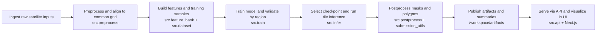

# GUMP System Design

This document visualizes the end-to-end solution from raw satellite inputs to interactive web outputs.

## Diagram A: End-to-End System Architecture

```mermaid
flowchart LR
  classDef data fill:#dbeafe,stroke:#2563eb,color:#1e3a8a
  classDef runtime fill:#dcfce7,stroke:#16a34a,color:#14532d
  classDef state fill:#fef3c7,stroke:#d97706,color:#78350f
  classDef ui fill:#fee2e2,stroke:#dc2626,color:#7f1d1d

  subgraph DataML[Data and ML Pipeline]
    D1[Raw data\nSentinel-1, Sentinel-2, AlphaEarth, labels]:::data
    D2[src.preprocess\nreproject, harmonize labels, build cache]:::data
    D3[/workspace/cache\nper-tile Zarr]:::state
    D4[src.train\nfeatures, split, model training]:::data
    D5[/workspace/runs\ncheckpoints, metrics, config]:::state
    D6[src.infer + src.postprocess\nthresholding, morphology, vector export]:::data
    D1 --> D2 --> D3 --> D4 --> D5 --> D6
  end

  subgraph Runtime[Runtime Services]
    R1[FastAPI\nsrc.api.main]:::runtime
    R2[Jobs API\nsrc.api.routes.jobs]:::runtime
    R3[Worker loop\nsrc.worker.main]:::runtime
    R4[Job executor\nsrc.worker.executor]:::runtime
    R5[GPU lock\nsrc.worker.gpu_lock]:::runtime
    R1 --> R2 --> R3 --> R4 --> R5
  end

  subgraph State[Storage and State]
    S1[/workspace/jobs\nqueued, running, done, failed]:::state
    S2[/workspace/artifacts\ngeojson, tifs, overlays]:::state
    S3[/workspace/state\ngpu.lock, app.db]:::state
    S4[src.common.paths\ncanonical path contracts]:::state
    S1 --- S2
    S2 --- S3
    S3 --- S4
  end

  subgraph UI[Frontend Consumption]
    U1[Next.js app\nwww/components/GumpApp.tsx]:::ui
    U2[Map and metrics UI\nfilters, confidence, exports]:::ui
    U3[API and static data\n/api/* and /public/data/*]:::ui
    U1 --> U2 --> U3
  end

  D6 --> S2
  R2 --> S1
  R4 --> S2
  R5 --> S3
  R1 --> U3
  S2 --> U3
```

Caption: The architecture separates heavy ML execution from HTTP request handling, while keeping outputs traceable as files under `/workspace`.

## Diagram B: Data-to-Insight Pipeline



Caption: The pipeline is designed for reproducibility: every stage writes explicit artifacts that can be inspected independently.

## Slide Mapping

Use the diagrams above directly in a 3-slide system design segment.

1. Slide 1: End-to-End Architecture
2. Slide 2: Data-to-Insight Pipeline
3. Slide 3: Reliability and Outputs

## Reliability and Outputs (Slide 3 Content)

- Async execution model: API enqueues jobs, worker executes, status tracked in `/workspace/jobs`.
- GPU safety: exclusive lock prevents overlapping inference/training jobs.
- Output contracts: each tile inference writes `summary.json`, `pred.geojson`, and raster artifacts.
- Frontend readiness: UI consumes both API metadata and static data artifacts without coupling to model internals.

## Evidence Anchors

- Preprocessing and cache creation: `src/preprocess.py`
- Training and checkpoint lifecycle: `src/train.py`
- Inference and postprocessing: `src/infer.py`, `src/postprocess.py`
- API boundary: `src/api/main.py`, `src/api/routes/jobs.py`
- Worker orchestration: `src/worker/main.py`, `src/worker/executor.py`
- Filesystem contracts: `src/common/paths.py`
- Frontend consumption: `www/components/GumpApp.tsx`